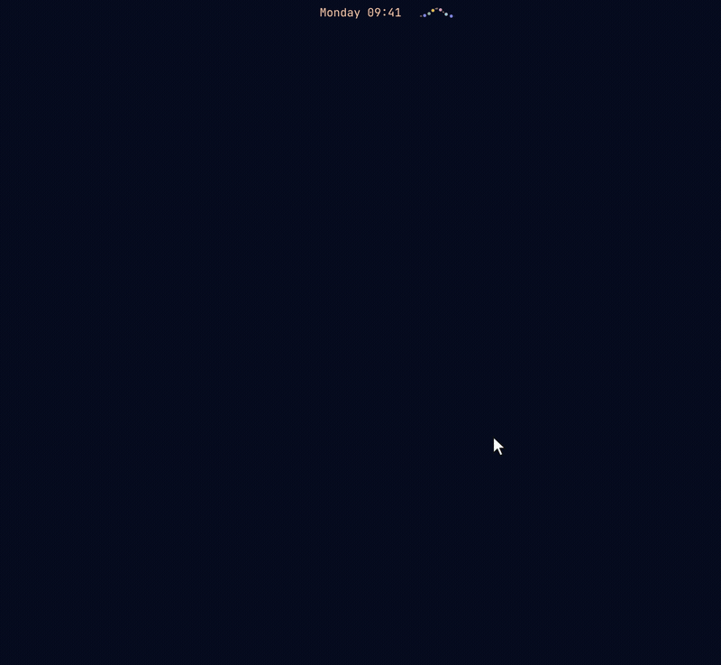

# Hill Chart for Omarchy

A [Shape Up](https://basecamp.com/shapeup/3.4-chapter-13) hill chart on the Omarchy bar. Each project is a dot on a hill. While you're still figuring out what the work is, it climbs. Once nothing about it is unknown, it's over the top. Then it rolls down while you make it happen.



- **Uphill (0–49%):** figuring things out.
- **The top (50%):** nothing about the work is unknown any more.
- **Downhill (51–99%):** making it happen.
- **Done (100%).**

A dot that sits uphill for a long time is what a hill chart is for spotting. Projects that haven't moved for a week get a red ring.

## Requirements

Omarchy 4 (Quattro): the Omarchy shell on Quickshell 0.3. Everything Hill Chart uses comes with Omarchy: Python 3 for its small file helper, and `setsid` and `kill` from util-linux. Nothing to build, and no setup step.

## Install

```bash
omarchy plugin add https://github.com/marcho78/omarchy-hillchart.git --enable
```

Omarchy shows what it's about to install and asks before it does. The hill goes on the right of the bar. Drag it anywhere on the bar, or move it from a terminal:

```bash
omarchy bar move marcho78.hillchart --section centerEnd
```

Hill Chart doesn't touch any of your configuration. It keeps your projects in a file of its own (see **Your projects**).

## Update

```bash
omarchy plugin update marcho78.hillchart
```

Omarchy fetches the new version, shows you what changed, and asks before it applies it. The shell keeps running the version it loaded, so restart it to switch:

```bash
omarchy restart shell
```

Restarting closes anything open in the shell, such as a panel or Omarchy's menu. Your projects stay as they are.

## Uninstall

```bash
omarchy plugin remove marcho78.hillchart
```

This takes Hill Chart off the bar, deletes its plugin folder, and removes its settings with its `shell.json` entry. Your projects stay in their file. To delete them too, remove that file, and the temp file of a save that was stopped part way if there is one, then its folder:

```bash
rm -f ~/.local/share/hillchart/projects.json ~/.local/share/hillchart/.projects.json.*.tmp
rmdir ~/.local/share/hillchart
```

`rmdir` only removes the folder if it's empty, so nothing else that's in it is touched. If you pointed the `dataFile` setting at a file of your own, remove that one instead.

## Use

| | |
|---|---|
| **Look** | Hover the bar hill. A card lists every project on a little hill of its own: the stretch it has already climbed, in its color, and how far along it is. |
| **Open** | Left-click the bar hill. Right-click opens it ready to type a new project. |
| **Move** | Drag a dot, or its label, along the hill. The dot rides the curve. The top and both ends pull it in, so 50% and 100% are easy to land on. |
| **Add** | Type a name in the field and press Enter. Or double-click the hill where the project already stands, then name it. |
| **Rename** | Double-click a name in the list, or use its ✎ button. |
| **Labels** | Double-click a label, or click the eye on its row, to hide it. Double-click the dot, or click the eye again, to bring it back. **Show all** and **Hide all** act on every label at once. |
| **Colors** | New projects get a color from your theme automatically. To pick your own, right-click a dot or click the color on its row, then click or drag in the picker. |
| **Done / remove** | Hover a row for ✓ and 🗑. **Clear N done** takes finished projects off the hill; they stay in the file. |
| **Undo** | Every change can be undone, so nothing asks "are you sure". |

### Keys

| Key | Does |
|---|---|
| `←` `→` / `h` `l` | Move the selected project 5% (`Shift`: 1%), on a 5% grid |
| `↑` `↓` / `k` `j` | Select the previous or next project along the hill |
| `Home` / `End` | Send it to the foot of the hill, or to done |
| `d` / `Space` | Done, or back to where it was before |
| `Enter` / `F2` | Rename |
| `Del` / `x` | Remove |
| `n` / `a` / `+` | Go to the new-project field |
| `t` | Hide or show the selected project's label |
| `Shift+T` | Hide all labels, or show them all when all are hidden |
| `c` | Pick a color for the selected project |
| `Ctrl+Z` / `u` | Undo |
| `Tab` | Next panel on the bar |
| `Esc` | Close the color picker or leave the text field, then close |

## Settings

Set these in **Setup › Plugins**, or on the widget's entry in `~/.config/omarchy/shell.json`:

| Key | Default | |
|---|---|---|
| `staleDays` | `7` | Days without movement before a project counts as stalled. `0` turns it off. |
| `dataFile` | *(empty)* | The projects file. It must be inside your home folder; empty means `~/.local/share/hillchart/projects.json`. Point it into a synced folder to share a hill between machines. |

## Your projects

Projects, with their labels, colors and a short history of where each has stood, are kept in one JSON file: `~/.local/share/hillchart/projects.json`, or the `dataFile` setting. The file is readable by you only, and so is its folder when Hill Chart creates it. Every bar on every monitor follows the file, so a change from anywhere shows up everywhere, the dots gliding to their new spots.

## Scripting

```bash
omarchy-shell marcho78.hillchart toggle
omarchy-shell marcho78.hillchart peek              # the hover card, for a few seconds
omarchy-shell marcho78.hillchart add "Billing"
omarchy-shell marcho78.hillchart addAt "Search" 30
omarchy-shell marcho78.hillchart move bill 60      # id, whole name, or a unique start of one
omarchy-shell marcho78.hillchart remove search
omarchy-shell marcho78.hillchart list              # JSON
```

To open the hill or glance at it from the keyboard, bind `toggle` or `peek` in `~/.config/hypr/bindings.lua`. A name you give on the command line is visible to other accounts in the process list while that command runs. Hill Chart itself never puts a project name on a command line.

## Security

Hill Chart runs as unsandboxed code in the Omarchy shell, like every shell plugin, so here is exactly what it does.

**No network, no root, nothing downloaded or compiled.**

**Programs.** Every command runs by absolute path with an argument list, never through a shell:

| Program | Why |
|---|---|
| `/usr/bin/python3 -I -S` with `bin/hillchart-files` | every file Hill Chart reads or writes (see **Files**) |
| `/usr/bin/setsid` | starts each helper run as its own process group |
| `/usr/bin/kill` | ends a helper run's whole group if it overruns |

Program paths are fixed in the code, never taken from `PATH` or other environment variables. Each helper run's output is counted in bytes as it arrives, against a fixed budget: 3 MiB for reading the projects, 192 KiB for the theme, 16 KiB for a save. Each also has a deadline of 5 to 10 seconds. Going over either ends the whole group. A run still going when Hill Chart unloads is ended the same way. The helper prints plain ASCII only, so no character is split when its output is taken in.

**Files.** The helper reaches every file the same careful way:

- It goes from `/` one folder at a time without following symbolic links.
- Every folder on the way must belong to you or root, and no one else can write to it.
- The file must be a regular file with a single link, yours, writable by no one else, and no bigger than a fixed size. Nothing is read past that size.

| File | Read | Written | Most |
|---|---|---|---|
| Your projects (`~/.local/share/hillchart/projects.json` or `dataFile`) | ✓ | ✓ | 1 MiB |
| Your theme's colors (`~/.local/state/omarchy/current/theme/colors.toml`) | ✓ | | 64 KiB |

- A save never writes into the projects file. It writes a new file created exclusively beside it (`.projects.json.<random>.tmp`, readable by you only), syncs it, and renames it over the old one.
- It only ever replaces a regular file of yours, never a link.
- Missing folders on the way are created readable by you only, and only inside your home folder.
- Project names reach the helper on its standard input, never on its command line.
- The temp file of a save stopped part way is removed by the next save once it's a minute old. Only names a save of Hill Chart's makes are removed.
- If the projects file can't be used (a link, someone else's, too big), Hill Chart says so in its panel and saves nothing, so a file it refused to read is never written over.

To notice changes made elsewhere, Hill Chart asks Quickshell to watch the projects file. The watch only reports that the file changed and never reads it; the helper does the reading. Its own words come from `i18n/` beside the code, read by Omarchy's translation component.

**What it shows.** Every piece of text, project names included, is shown as plain text, never as markup. The text fields are editable only while the panel is open: the panel stays loaded in the shell after it closes, and an editable field has Qt read the clipboard every time it changes.

## Development

```bash
node tests/model.test.mjs
QT_QPA_PLATFORM=offscreen /usr/lib/qt6/bin/qmltestrunner -input tests/qml
python3 -B -m unittest discover -s tests -p "test_*.py"

omarchy plugin validate "$PWD"
qmllint -I "$OMARCHY_PATH/shell" *.qml
```

| File | |
|---|---|
| `BarWidget.qml` | Entry point: the bar hill, the projects file, the keys, and the panel |
| `HillView.qml` | The hill in the panel: curve, dots, labels, dragging, trail, celebrations |
| `MiniHill.qml` | The hill at bar size |
| `HoverCard.qml` | The card that hovering the bar hill shows |
| `HillGlyph.qml` | One project's hill at word size, in the hover card |
| `ColorPicker.qml` | The shade square and hue strip for picking a project's color |
| `ProjectRow.qml` | A row in the list under the hill |
| `Run.qml` | Runs one command with a byte budget, a deadline and its own process group |
| `HillModel.js` | Pure logic: the hill's shape, the projects document, label layout, time |
| `bin/hillchart-files` | Every file read and write |
| `i18n/en.json` | Strings. Add `<lang>.json` beside it to translate. |

## Changelog

What changed in each version is in [CHANGELOG.md](CHANGELOG.md).

## License

MIT. See [LICENSE](LICENSE).
